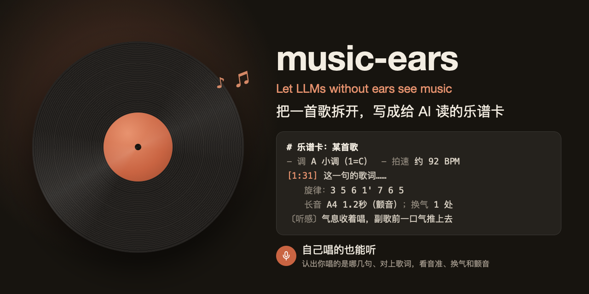

# music-ears



Let LLMs without ears see music

让听不见声音的 AI "看见"一首歌：把歌拆开、量出来，写成一张给 AI 读的**乐谱卡**。

> 作者在 macOS 上用；Linux、Windows 走 Docker 里的转码，测过转码那一步，整套流程还没在别的系统上从头跑过。

先看一眼：[乐谱卡长这样](docs/example-card.md)。

## 适合什么场景

- **和 AI 一起聊歌**：AI 听不见声音，给它一张乐谱卡，它就能说出这首歌哪里转调、副歌怎么推上去、歌手在哪换气、哪句用了颤音，聊起来不再只能谈歌词。
- **AI 陪伴、角色扮演里"一起听歌"**：发一首歌给你的 AI 伙伴，它能接着具体的旋律和唱法回应你，而不是泛泛地说"好听"。
- **练歌**：录一段自己唱的，看调、音域、每句的旋律、长音和颤音、哪些音偏了 30 音分以上，再让 AI 给建议。
- **写词、编曲找参考**：快速拿到一首歌的调、拍速、按拍的和弦、段落结构。
- **能跑命令的 AI**（比如 Claude Code）可以自己调用它：你贴个链接，它自己拆、自己读卡。

**不适合**：要求精确的扒谱、专业转录。数字是脚本量的，滑音、合唱、童声会让它冒出不存在的调外音；乐谱卡给 AI 理解用，不是给人照着弹的谱子。

## 在 Claude 手机 App（或网页版）里用

music-ears 要跑在电脑上（需要 Docker 和 Python），手机 App 里的 Claude 没法自己运行它。但乐谱卡就是一个文字文件，所以可以这样用：

1. 在电脑上做卡：`music-ears 网易云链接`，做好会打印卡的路径（`cache/<编号>/card.md`）；也可以用 `music-ears show 歌名` 把整张卡打印出来。
2. 把卡发给 Claude：在手机 App 或网页版的对话里，把 `card.md` 当文件附上，或者直接粘贴卡的全文。
3. 跟它说一句"这是这首歌的乐谱卡，我们边听边聊"。手机上一边放歌，一边按卡上的时间问它，比如"1:32 那句你怎么看"。

想让它像"一起听"那样跟着进度走，就在问的时候带上你听到第几分第几秒，它会去卡里找对应的那几句。

## 它做什么

贴一个网易云音乐的链接，或者给一段录音，大约 6–8 分钟后得到一张乐谱卡（Markdown），里面有：

- **客观测量**：调（附简谱的 1=?）、拍速、按拍的和弦、人声逐句的旋律简谱和音高、换气、长音、颤音、音域；
- **对上歌词**：每句歌词对应的时间和旋律；
- **模型听感**：把每一段的音频连同测量结果交给能听音频的模型，写情绪、气息、唱法、音色、伴奏、词和旋律的关系；再让另一个模型逐段对照音频审查一遍，量错的地方指出来。

也能听**自己唱的**录音：先认出唱的是哪几句，再对上歌词。

## 流程

```
网易云链接 / 录音
  → 取音频和歌词（src/netease.py）
  → 分轨：人声 / 伴奏（Demucs htdemucs）
  → 拍速、拍点、调、和弦（librosa，用伴奏轨）
  → 人声逐帧音高（torchcrepe）→ 切成音符、简谱、换气、颤音（src/measure.py）
  → 自己唱的：认字、对歌词（src/align.py）
  → 模型逐段听、再审查（src/listen.py）
  → 写成乐谱卡（src/card.py）
```

## 用法

```
music-ears 网易云链接或歌曲编号             取歌词和音频，量，写乐谱卡
music-ears 链接 --audio 录音.m4a            用自己的音频（比如会员歌的录屏），歌词照样从网易云取
music-ears 链接 --audio 录音.m4a --sung     自己唱的
music-ears 链接 --no-listen                 只量不听：不调模型、不要钥匙
music-ears --audio 录音.m4a [--name 歌名] [--lrc 歌词.lrc]   没有网易云链接：量音频，给了 LRC 歌词就逐句对上
music-ears info 链接                        只看链接：歌名、歌手、是不是会员歌、做过没有
music-ears list                             做过的歌
music-ears show 关键词                      打印某首的乐谱卡
music-ears serve                            黑胶播放器（网页）+ 一起听接口 + MCP（/mcp）
```

做过的歌会缓存在 `cache/`（不进仓库），再要就直接拿。

还有给播放器用的几条（网易云扫码登录、歌单、搜索、播放地址、歌词，都回 JSON），播放器本身见下一节。

## 黑胶播放器和一起听

```
music-ears serve
```

浏览器打开 <http://127.0.0.1:8790/> 就是一个黑胶播放器：你的网易云歌单、搜索、全屏歌词、锁屏控制。点歌右边的「⋯」→「一起听」，这首会先拆成乐谱卡，然后开始放；放的过程中，AI 读 `http://127.0.0.1:8790/api/now?format=text` 就知道你放到哪一句，还附上乐谱卡里前后十秒的旋律、和弦、唱法。

手机上用、嵌进你自己的聊天前端、接给 AI，见 [docs/player.md](docs/player.md)。

## 接给 AI（MCP）

`music-ears serve` 同时是一个 MCP 服务（`/mcp`）：搜歌、拆歌、读卡、一起听。Claude Code、Claude Desktop、Claude 手机 App 的自定义连接器、Aru 都能接，怎么接见 [docs/mcp.md](docs/mcp.md)。

## 需要什么

- **系统**：macOS 转音频用系统自带的 `afconvert`；Linux、Windows 在 Docker 容器里用 PyAV（自带 ffmpeg 解码器）转，要在 venv 里装上 `av`（已写进 requirements.txt）；
- **Docker**：测量那一步放在 `python:3.12-slim` 容器里跑，代码和环境从本目录挂进去；
- **Python 库**：见 `requirements.txt`（demucs、librosa、torch、torchcrepe 等，只有测量要）；
- **模型钥匙**（三个，都可以在设置里换成别家）：
  - **听**：能输入音频的模型，OpenAI 兼容格式，默认阿里云百炼的通义千问 Omni；
  - **审查**：Gemini 原生格式（有些中转的 OpenAI 格式会把音频丢掉）；
  - **认字**：只有听自己唱的（`--sung`）才用，默认百炼的 qwen3-asr-flash。
- **没有钥匙也能先试**：不配钥匙（或者加 `--no-listen`）就只量不听，卡里有调、拍速、和弦、逐句旋律，没有模型写的听感。

## 安装

```
git clone https://github.com/White-ting/music-ears.git && cd music-ears
docker run --rm -v "$PWD":/w python:3.12-slim sh -c "python -m venv /w/venv && /w/venv/bin/pip install -r /w/requirements.txt"
mkdir -p ~/.config/music-ears/keys
```

（x86 电脑上 pip 默认会装带 CUDA 的 PyTorch，很大；只用 CPU 的话，pip install 后面加 `--extra-index-url https://download.pytorch.org/whl/cpu`。）

然后把钥匙各写进一个文件（只写一行钥匙）：

- `~/.config/music-ears/keys/dashscope.key`：百炼的钥匙（听、认字）
- `~/.config/music-ears/keys/gemini.key`：Gemini 的钥匙（审查）

第一次量歌时会自动下载 Demucs 和 CREPE 的模型，放在本目录的 `models/`，大约 500MB。

## 设置

都是可选的，写在 `~/.config/music-ears/config.json`，只写要改的项：

```json
{
  "name": "小明",
  "docker": "docker",
  "tz": "Asia/Shanghai",
  "models": {
    "review": {"base": "https://你的中转/v1beta", "key_file": "~/.config/music-ears/keys/review.key"}
  }
}
```

- `name`：听你自己唱的、你发的录音时，乐谱卡上怎么称呼你（默认"用户"）；
- `docker`：docker 命令不在 PATH 里时写完整路径；
- `tz`：记录时间用的时区，不写就是系统时区；
- `models`：换模型、换接口地址、换钥匙文件。每项能写的字段见 `src/config.py`。

## QQ 音乐、酷狗、Apple Music 等别的平台

现在**只有网易云**能贴链接：歌名、歌手、歌词、免费歌的音频都自动取，扫码登录后会员歌也能取。别的平台没有接，原因是各家的接口都不公开、也都不一样，要一家家去做。

别的平台的歌照样能拆，只是要自己给材料：

```
music-ears --audio 录音.m4a --name "歌名" --lrc 歌词.lrc
```

- **音频**：用手机录屏放歌、转成音频，或者用你有权使用的音频文件。录屏开头多一点、少一点没关系，会自动按第一句对齐；但要从歌的开头录，从中间开始录的对不上歌词。
- **歌词**：LRC 格式（每行前面带 `[分:秒]` 时间）。很多播放器能导出或在网上找到；不给歌词也行，乐谱卡就只有按时间排的旋律，没有逐句歌词。
- **自己唱的**：加 `--sung`，会先认出你唱的是哪几句，再对上 LRC 里的歌词，从中间唱也行。
- 跟网易云链接比，少的只是"自动取"：卡的内容（调、拍速、和弦、旋律、听感、审查）一样。

## 关于网易云

`src/netease.py` 和 `src/nmcrypto.py` 用的是网易云网页端的**非官方接口**，只为个人学习研究：取歌词、取免费歌的试听音频、扫码登录后取自己有权限的歌。请尊重版权，不要拿它批量下载或传播音乐。整理成公开版时，这部分可能默认不带。

## 第三方

用到的开源库和模型见 [NOTICE.md](NOTICE.md)。

## 已知的不足

- 主要在 macOS 上用过；Linux、Windows 只测过转音频那一步。
- 一首 4 分钟的歌要 6–8 分钟，大头是分轨和逐段请模型听。
- 量出来的数会错：滑音会被切成一个短音、合唱和童声会冒出不存在的调外音，乐谱卡里也写明了这一点。
- 录音要从歌的开头录，从中间开始录的对不上歌词（自己唱的除外，会先认字再对）。
- 只有网易云能贴链接；网易云的接口不是官方的，哪天改了就可能取不到。

## 反馈问题

遇到 bug、有想法，到 [Issues](https://github.com/White-ting/music-ears/issues) 里新建一条。写清楚这几样会帮很大忙：

1. **跑的命令**：比如 `music-ears 链接 --audio 录音.m4a`；
2. **出了什么事**：报错的最后几行原文，或者乐谱卡里哪一段不对（贴那几行）；
3. **是哪首歌**：网易云链接，或者歌名和歌手；是不是会员歌、是不是自己唱的；
4. **环境**：什么系统、哪个版本，Docker 用的是什么（Docker Desktop、OrbStack……）。

**别贴**：钥匙、`~/.config/music-ears/` 里的文件、网易云的登录信息（netease-cookie），这些都是你的私人凭证。

## 许可证

[MIT](LICENSE)：可以自由使用、修改、分发，保留原作者署名和许可声明即可。第三方库和模型按各自的许可证（见 NOTICE.md）。
